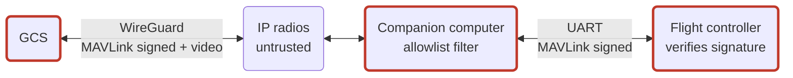

# P1: Security architecture and requirements for a notional small UAS

[](https://github.com/samyoon727ca/uas-sec-p1-architecture/actions/workflows/validate.yml)

This repo is the security architecture, threat model and derived requirements for a notional, unclassified small UAS. The UAS is built from open-source parts: a PX4 flight controller, a Linux companion computer, a ground control station, and a MAVLink telemetry/C2 link. P1 is the anchor for five follow-on repos, P2–P6. Each one implements and verifies requirements allocated here.

> **Notional and unclassified.** Built only from public sources: PX4 and MAVLink documentation, NIST, MITRE. It is not based on any real program or system. Assumptions are labeled as assumptions.

**Five-minute version:** the 11-slide PDR-style brief, as [PDF](brief/pdr-brief.pdf) or [Markdown](brief/pdr-brief.md).

**From first principles:** the [project overview](overview/overview.pdf) (PDF) explains the system, P2's verified boot, measured boot and TPM key sealing, every P2 test case and its evidence, and how to rebuild and rerun the tests. Its tables and statuses are generated from P1's data and a pinned P2 snapshot ([`overview/`](overview/)).

**How the repo works:** the [guide](docs/GUIDE.md) covers its data flow, tools, checks and open edges.

**Status: baseline 1.0, complete (October 2026).**

All P1 deliverables are in place and checked in CI: architecture, threat model, resiliency mapping, requirements, verification plan, SysML v2 model and brief. Still open, each tracked to its owner:

- **OI-01:** QGroundControl and PX4 signing interoperability. Closed by VE-02 in P3.
- **OI-02:** per-node authentication to the FC. Trade study in P3.
- **OI-03:** no independent C2 path. Deferred to a later P1 revision.
- **DD-06:** re-pin from PX4 `v1.18.0-rc1` to `v1.18.0` once PX4 releases it.

16 of 17 verification events are planned, with results arriving as P2–P6 produce evidence. VE-02 is partly evidenced by P3 ([summary](https://github.com/samyoon727ca/uas-sec-p3-pki/blob/813ad2fb61338fce87b7a776267d26b56c3a3175/evidence/ve02-phaseA/ve02-phaseA.md), from [sitl-phase0 run 44631064225](https://github.com/samyoon727ca/uas-sec-p3-pki/actions/runs/44631064225) at harness commit `782ca162623257a6f71d77232e3674fceeb01f14`), and its QGroundControl steps 2, 3 and 6 wait on uas-sec-p3-pki#6.

## Threat

66 threats, analyzed STRIDE per element across all 40 STRIDE elements (46 data-flow-diagram elements, less 6 trust boundaries) and mapped to MITRE EMB3D v2.0.2 and ATT&CK for ICS v19.2. Mission-impact ratings: 42 MI-1, 16 MI-2, 6 MI-3, 2 MI-4. 63 are mitigated and 3 accepted with rationale.

**Headline finding.** PX4 MAVLink signing uses one shared key. The FC, companion computer (CC), GCS and maintenance station (MSS) all hold it, so most MI-1 threats end the same way: an adversary holds that key, or runs code on a node that does.

**Priority threats:**

| Threat | Impact | Mitigated by |
|---|---|---|
| THR-010 Code execution on the CC yields full vehicle C2 | MI-1 | SR-001, SR-005, SR-008, SR-009 |
| THR-001 Spoofed GCS heartbeats suppress the data-link-loss failsafe | MI-1 | SR-001 (tested by VE-01) |
| THR-026, THR-027 Signing key read, replaced or deleted on the FC's SD card | MI-1 | SR-023, SR-025, SR-036 |
| THR-057 Unauthorized peer installs the first signing key | MI-2 | SR-011, SR-025, SR-037 |
| THR-021, THR-063 Malicious code enters signed artifacts | MI-1 | SR-031, SR-032, SR-033 |

The full analysis, STRIDE coverage matrix, accepted risks and residual risk are in [`docs/05-threat-model.md`](docs/05-threat-model.md).

## Requirements

45 derived "shall" requirements. Each one traces to at least one threat, is allocated to one component (CC 15, MSS 13, FC 9, GCS 8), and names a verification method (Test 24, Inspection 13, Demonstration 8) and an evidence repo.

Example: **SR-001** (CC) — the CC shall discard all traffic on its radio interface except WireGuard traffic from the provisioned GCS peer. Verified by Test (VE-01), with evidence from P3.

The full table with parent threats is in [`docs/07-requirements.md`](docs/07-requirements.md).

## Design

Radio → CC → FC (DD-01). C2 is protected in layers:

1. **WireGuard tunnel, GCS to CC (DD-02).** Carries MAVLink and video, and provides confidentiality across the untrusted RF link.
2. **CC allowlist (DD-04).** Filters MAVLink messages and commands. It is defense in depth, not an authentication point.
3. **MAVLink signing, GCS to FC.** This is design intent. It is not yet demonstrated with the pinned QGroundControl and PX4 versions (open item OI-01, closed by VE-02).

The FC–CC boundary uses only signed MAVLink over UART, and uXRCE-DDS is disabled (DD-03), because MAVLink signing doesn't cover DDS.

The design uses 11 of the 14 NIST SP 800-160 Vol. 2 cyber resiliency techniques. Its main gap is Path Diversity: no C2 path bypasses the CC ([§6](docs/06-cyber-resiliency.md), OI-03).



Read more:
- [System description](docs/01-system-description.md)
- [CONOPS](docs/02-conops.md)
- [Assumptions](docs/03-assumptions.md)
- [Architecture and design decisions](docs/04-architecture.md)

## Verification evidence

Traceability is checked automatically on every push. [`tools/validate_trace.py`](tools/validate_trace.py) fails the build if any of these hold:

- a threat is neither mitigated nor explicitly accepted;
- a requirement has no parent threat, has no allocated component, or can't be verified;
- an ID is orphaned;
- an architecture element has no threat analysis;
- a STRIDE category is applied to an element type it doesn't fit;
- an EMB3D or ATT&CK for ICS ID, or an SP 800-160 resiliency approach, is not in its pinned catalog (revoked IDs included);
- a requirement is not covered by a verification event with the same method and evidence repo;
- a verification event is marked passed or failed without a link to its evidence, pinned to a commit;
- a count that this README or the brief states (threats, elements, mission-impact ratings, dispositions, requirements by component, method and repo, resiliency techniques and approaches, verification events) differs from the CSVs, or a sentence that states one no longer matches its pattern;
- a row in the priority-threat tables of this README or [`docs/05-threat-model.md`](docs/05-threat-model.md) (§5.3) omits a requirement traced in `data/trace.csv`, lists an untraced requirement, or disagrees with `data/requirements.csv` on its evidence repos;
- a generated doc view or the generated SysML model has drifted from the CSVs;
- the SysML v2 model fails validation on the OMG Pilot Implementation.

The column rules are in [`data/README.md`](data/README.md).

17 verification events cover all 45 requirements ([`docs/08-verification-plan.md`](docs/08-verification-plan.md)). Evidence for each will come from the follow-on repos:

<!-- BEGIN GENERATED: series-table -->
| Repo | Scope | Requirements | Verification events | Status |
|---|---|---|---|---|
| [P2](https://github.com/samyoon727ca/uas-sec-p2-verified-boot) | Verified boot chain | 3 | VE-07, VE-08 | planned: VE-07, VE-08 ([emulation-only evidence](overview/p2-snapshot/evidence/)) |
| [P3](https://github.com/samyoon727ca/uas-sec-p3-pki) | PKI, key management and signed updates; SITL harness | 14 | VE-01 to VE-06, VE-17 | planned: VE-01, VE-03 to VE-06, VE-17; partly evidenced: [VE-02](https://github.com/samyoon727ca/uas-sec-p3-pki/blob/813ad2fb61338fce87b7a776267d26b56c3a3175/evidence/ve02-phaseA/ve02-phaseA.md) |
| [P4](https://github.com/samyoon727ca/uas-sec-p4-cc) | Hardened CC image, MSS pipeline and supply chain | 14 | VE-09 to VE-11 | planned: VE-09 to VE-11<br>Allocation pending decision: Repo is the MAVLink proxy for VE-10 ([series alignment](docs/series-alignment.md#p4-cc-hardening-and-supply-chain)) |
| [P5](https://github.com/samyoon727ca/uas-sec-p5-fault-sim) | Hardware and firmware security assessment | 2 | VE-12, VE-13 | planned: VE-12, VE-13<br>Allocation pending decision: Repo is fault injection on the PX4 bootloader ([series alignment](docs/series-alignment.md#p5-hardware-and-firmware-assessment)) |
| [P6](https://github.com/samyoon727ca/uas-sec-oscal) | RMF-as-code (OSCAL): configuration and procedure evidence | 12 | VE-14 to VE-16 | planned: VE-14 to VE-16<br>Allocation pending decision: Repo is the OSCAL pilot on VE-07 ([series alignment](docs/series-alignment.md#p6-rmf-as-code-oscal)) |
<!-- END GENERATED: series-table -->

The table is generated by `tools/render_views.py` from [`data/series.csv`](data/series.csv), [`data/verification.csv`](data/verification.csv) and the status snapshots in [`data/series-status/`](data/series-status/); don't edit it by hand.

## Repository map

| Path | Contents | Status |
|---|---|---|
| [`docs/01-system-description.md`](docs/01-system-description.md) | Purpose, scope, components, key material, software baseline | Baselined |
| [`docs/02-conops.md`](docs/02-conops.md) | Mission phases, actors, modes, contingencies | Baselined |
| [`docs/03-assumptions.md`](docs/03-assumptions.md) | Labeled assumptions `A-##` | Baselined |
| [`docs/04-architecture.md`](docs/04-architecture.md) | Data flows, trust boundaries, C2 trust base, design decisions | Baselined |
| [`docs/05-threat-model.md`](docs/05-threat-model.md) | STRIDE per element, EMB3D, ATT&CK for ICS, priority and accepted risks | Baselined |
| [`docs/06-cyber-resiliency.md`](docs/06-cyber-resiliency.md) | NIST SP 800-160 Vol. 2 techniques and approaches mapped to the design; gaps | Baselined |
| [`docs/07-requirements.md`](docs/07-requirements.md) | Requirement conventions; full table with parent threats | Baselined |
| [`docs/08-verification-plan.md`](docs/08-verification-plan.md) | 17 verification events covering all requirements; VE-01 and VE-02 in full | Baselined |
| [`docs/references.md`](docs/references.md) | Sources, with pinned versions | Baselined |
| [`docs/series-alignment.md`](docs/series-alignment.md) | Where P4, P5, P6 and a possible P7 depart from P1's VE allocation; options and decision log | Draft: awaiting owner decision |
| [`data/`](data/) | Elements, threats, requirements, trace and verification (CSV); pinned framework catalogs | Populated |
| [`model/sysml/`](model/sysml/) | SysML v2 model: hand-written architecture, plus threats, requirements and verification generated from the CSVs; validated on the OMG Pilot Implementation | Baselined |
| [`brief/`](brief/) | 11-slide PDR-style brief (Marp source and PDF). Diagrams are rendered from the docs; the PDF is built in CI with a pinned toolchain | Baselined |
| [`overview/`](overview/) | Project overview from first principles (Markdown sources and PDF): P1, P2 in full, a roadmap for P3–P6, and the limitations and open findings of the 2026-10-13 audit, generated from `overview/audit/findings.json`. Tables and statuses are generated from `data/` and a pinned P2 snapshot (`overview/p2-snapshot/`, checked by `tools/check_p2_snapshot.py`); the PDF is built in CI with a pinned toolchain (the brief's mermaid-cli and puppeteer, plus markdown-it) | Draft: audit findings open, awaiting triage |

## Run the checks locally

```sh
python -m unittest discover -s tests
python tools/validate_trace.py
python tools/render_views.py --check
python tools/gen_sysml.py --check
tools/sysml/validate.sh   # Java 21+; downloads the pinned SysML v2 Pilot Implementation once
CHROME_PATH=/path/to/chrome brief/build.sh   # Node 22+; rebuilds brief/pdr-brief.pdf
python tools/check_p2_snapshot.py            # needs network; overview/p2-snapshot matches P2
CHROME_PATH=/path/to/chrome overview/build.sh   # Node 22+, git; rebuilds overview/overview.pdf
python tools/fetch_series_status.py          # needs network; refreshes data/series-status/ from P2–P6
python tools/check_series_status.py data/series-status/*.json   # if any snapshots exist
```

The [`series-status`](.github/workflows/series-status.yml) workflow runs daily (or on demand from the Actions tab) and does the same: it fetches each series repo's `series-status.json`, checks it, regenerates the series table, runs `validate_trace.py`, and opens or updates a PR on `bot/series-status` if anything changed. It uses only `GITHUB_TOKEN`, so the repo setting "Allow GitHub Actions to create and approve pull requests" must be on. A status file that claims a VE not allocated to its repo fails the run. The fetcher removes snapshots of repos no longer in `series.csv`. `validate.yml` does not run on the bot PR (pushes made with `GITHUB_TOKEN` don't trigger workflows), so the PR body links the run that checked it. `fetch_series_status.py --base-url` points the fetcher at another server or a `file://` folder laid out as `<repo>/HEAD/series-status.json`.

Python 3.11+. Standard library only.

## License

[Apache-2.0](LICENSE)
