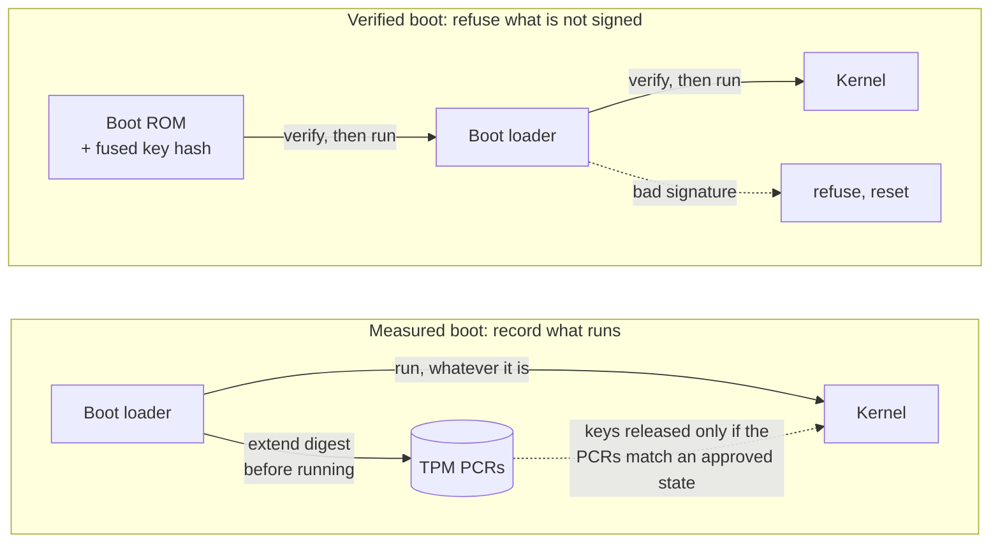
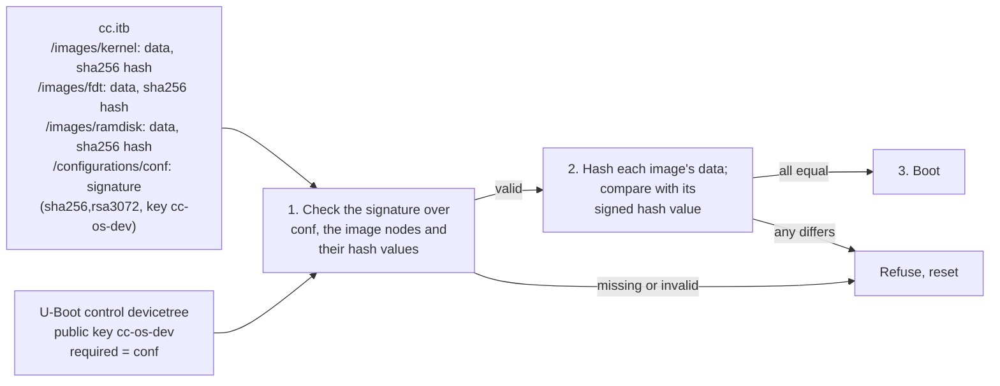
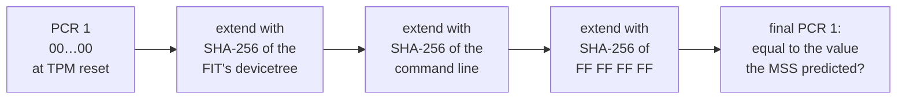
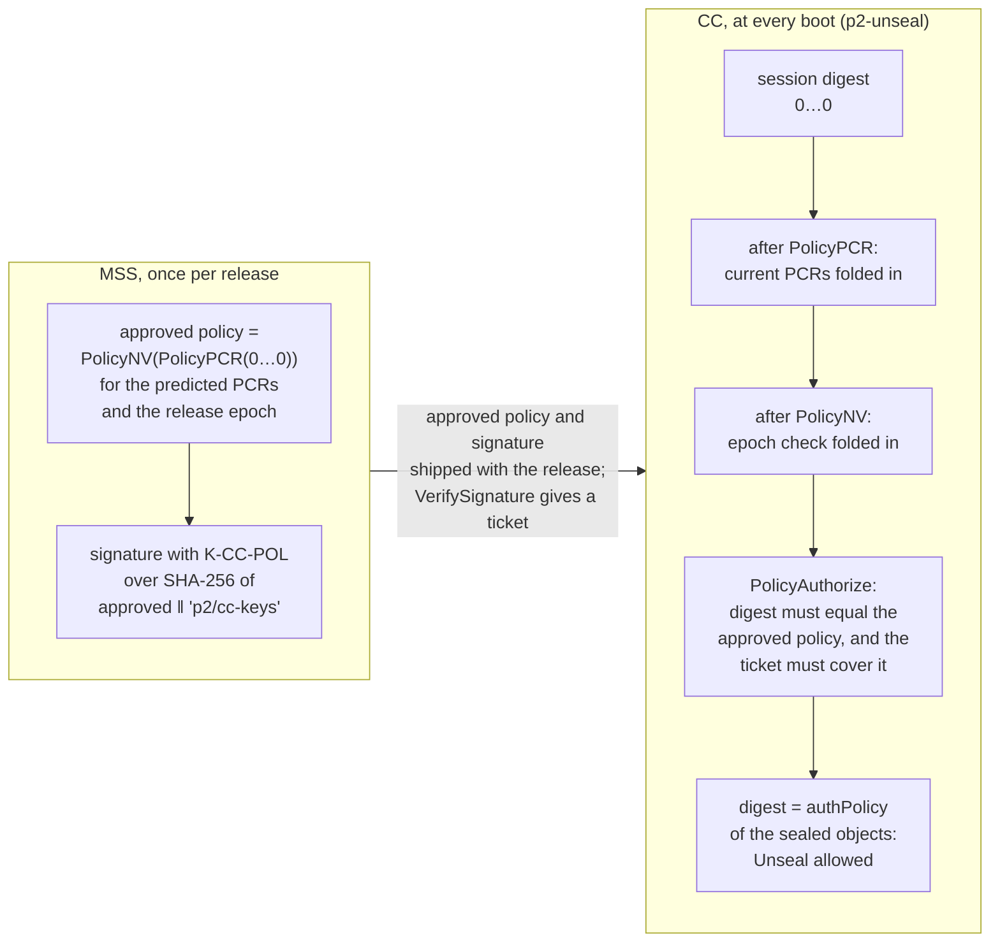
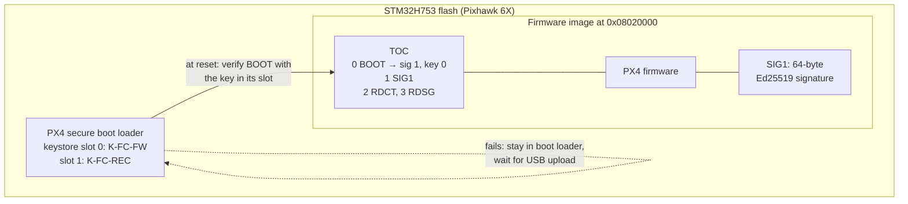
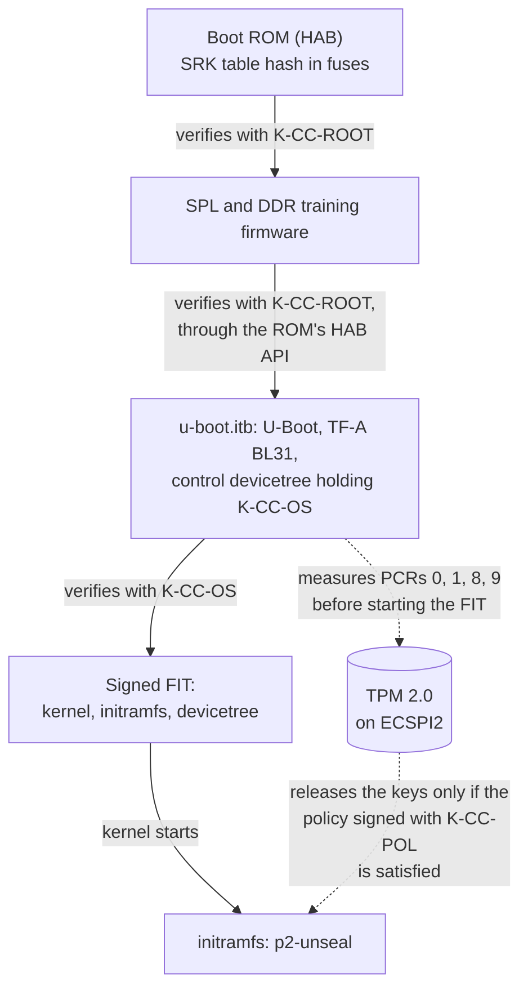
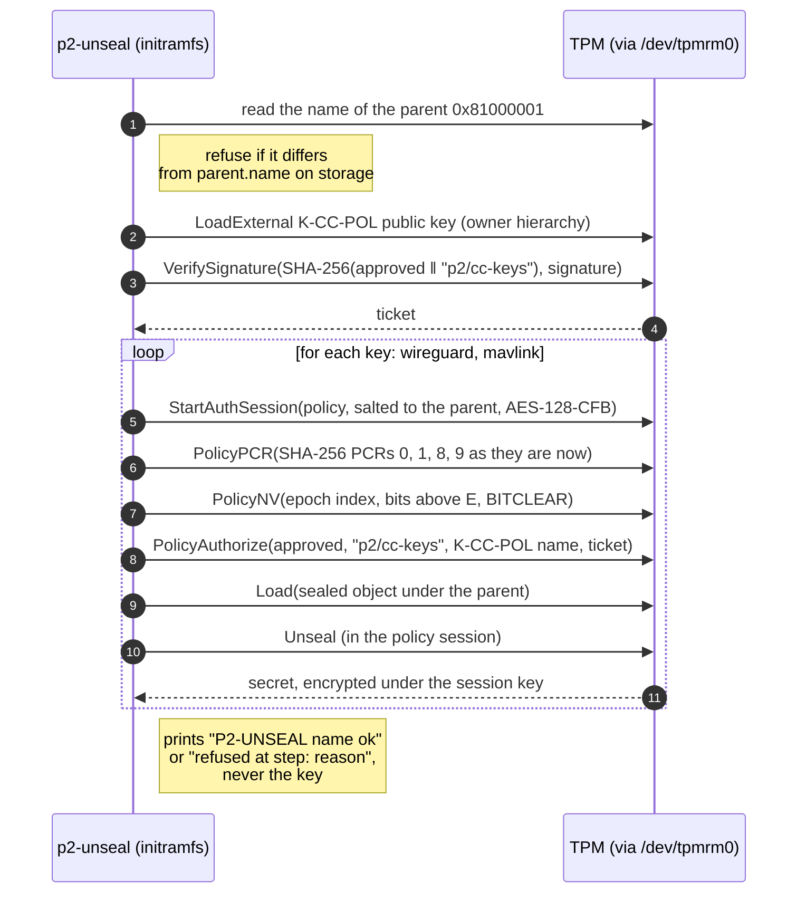
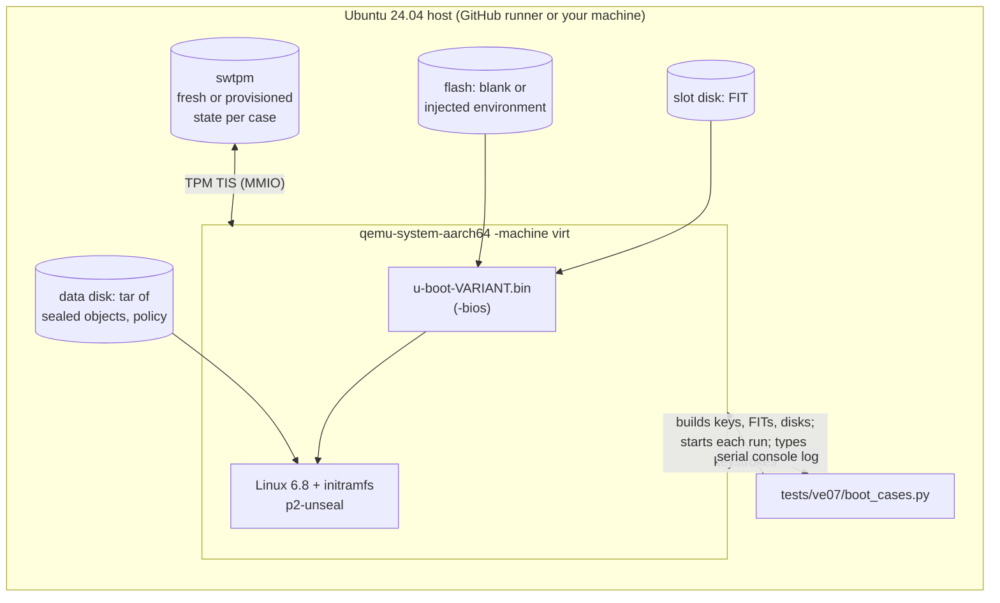
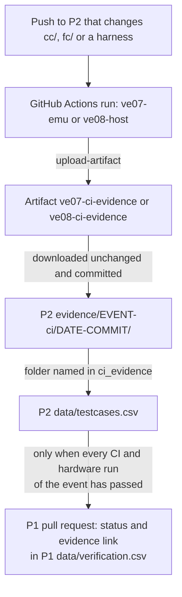

# P2: verified boot, measured boot and key sealing {#p2}

P2 (`{{p2.repo}}`) produces the verification evidence for the P1 requirements of the previous chapter: the companion computer boots only a signed chain verified from a hardware root of trust (SR-005); its keys are sealed to its TPM and released only to the measured boot state (SR-010); the PX4 flight controller boots only signed firmware (SR-018). It does so through P1's verification events VE-07 and VE-08, split into {{p2.tcs}} test cases (P2 `README.md`).

This chapter states P2 as of commit `{{p2.commit}}`. Where it is now:

<!-- gen: p2-ve-status -->

*Generated from the P2 snapshot (`data/testcases.csv`) with P2's own roll-up rule, and from P1's `data/verification.csv` for the P1 status.*

In CI, {{p2.tcs_ci_passed}} of {{p2.tcs_ci}} test cases have passed, in emulation or on the host; on hardware, {{p2.tcs_hw_passed}} of {{p2.tcs_hw}}. The companion-computer board, a DEBIX Model A (NXP i.MX 8M Plus), is on order (P2 `docs/02-cc-boot-chain.md`, status paragraph). P2's documents specify "an SPI TPM 2.0 module on ECSPI2" but name no module (P2 `docs/02-cc-boot-chain.md` §2.1); according to the project owner, the module has not been chosen yet. P2's rule is that nothing is called working until its test case passes (P2 `docs/06-verification.md`), and this document follows it: an emulated pass is described as exactly that.

## What P2 must show {#p2-scope}

P2 refines a P1 requirement only where it cannot be tested as written. A child requirement keeps its parent's component and verification method and traces only to its parent's P1 threats; a threat P1 lacks goes back to P1 as a proposed change instead (P2 `docs/01-scope-and-trace.md` §1.2). There are {{p2.children}} children:

<!-- gen: p2-children -->

*P2's child requirements, generated from the P2 snapshot (`data/requirements.csv`, `data/trace.csv`, `data/testcases.csv`).*

SR-018 has no child. Its gaps were P1-level, so P2 proposed them to P1, which adopted them: THR-066 (older signed firmware) with SR-045, and the dependence of SR-018 on SR-024 (P2 `docs/01-scope-and-trace.md` §1.4).

P2 also works under six assumptions of its own (P2 `docs/01-scope-and-trace.md` §1.3). Each is accepted for analysis, not shown:

| ID | Assumption (summarized) | Why it matters |
|---|---|---|
| A2-01 | Every `u-boot.itb` ever signed with the root key has measured boot enabled | A signed U-Boot that does not measure leaves the PCRs at reset values; with a verification flaw, the kernel it started could extend the approved values itself |
| A2-02 | The TPM resets only at power-on; its reset pin is not driven by software (DD2-17) | A TPM reset on its own returns its PCRs to zero, so approved measurements could be replayed. P5 covers physical attack |
| A2-03 | In emulation, QEMU loading `u-boot.bin` and its control devicetree stands in for the hardware root of trust | Emulation cannot show a modified boot loader being refused; TC-02 is hardware only |
| A2-04 | swtpm 0.7.3 implements the TPM 2.0 commands P2 uses as the TCG specifies | swtpm is not a certified TPM and keeps its state in a host file; the hardware runs repeat the sealing cases |
| A2-05 | PX4 Bootloader Secure Boot behaves the same at `v1.18.0` as at `v1.18.0-rc1` | Rechecked at the PX4 re-pin (P1 DD-06) |
| A2-06 | U-Boot's ECSPI driver can drive the chosen SPI TPM on the DEBIX | Measured boot on the hardware depends on it (OI2-01) |

## Concepts {#concepts}

This section explains every idea the P2 design uses, in the order the design needs them. Each subsection ends with how P2 uses the idea.

### Hashes and digital signatures {#c-signatures}

A **cryptographic hash** such as SHA-256 maps any input to a fixed 32-byte digest. Changing one bit of the input changes the digest unpredictably, and finding two inputs with the same digest is infeasible. A digest is therefore a short, reliable name for exact content: if the digest of what you have equals a digest you trust, you have the trusted content.

A **digital signature** binds content to a key pair. The holder of the private key signs (a digest of) the content; anyone holding the matching public key can verify the signature, and nobody without the private key can produce one that verifies. A verifier therefore needs two things it can trust: the verification code, and the public key. Everything in secure boot is about where those two come from.

P2 uses four signature algorithms, each fixed by the verifier that checks it (P2 `docs/05-key-management.md` §5.1): RSA-4096 for the root boot key K-CC-ROOT (checked by the i.MX boot ROM), RSA-3072 for the OS key K-CC-OS (checked by U-Boot), ECDSA P-256 for the policy key K-CC-POL (checked by the TPM) and Ed25519 for the flight-controller keys K-FC-FW and K-FC-REC (checked by the PX4 boot loader). NIST SP 800-57 rates RSA-3072 and ECDSA P-256 at 128 bits of security strength; RSA-4096 falls between its 128-bit and 192-bit rows, so P2 counts it as 128 bits (P2 `docs/references.md`, [SP800-57]). P2 gives Ed25519 no strength figure, because its 253-bit group order falls in that table's 112-bit row while it is commonly described as 128-bit (P2 `docs/05-key-management.md` §5.1).

### Roots of trust, verified boot and measured boot {#c-root}

**Verified boot** is a chain: each stage checks the signature of the next stage before running it, and refuses to run it if the check fails. A chain is only as strong as its first link, so the first check must be made by code and a key that an attacker cannot change. On a system-on-chip that is a **hardware root of trust**: verification code in mask ROM, which cannot be rewritten, and a public key (or its hash) burned into one-time-programmable fuses.

**Measured boot** is different. Each stage *records* a digest of the next stage in a TPM before running it, and runs it whatever it is. Nothing is refused; instead the TPM ends up holding an unforgeable summary of what booted. That summary can then gate a decision, such as releasing a key.

P1's assumption A-04 keeps the two apart: SoC secure boot verifies the chain (SR-005), and the TPM measures and seals (SR-010). A TPM cannot stand in for secure boot, because it stops nothing (P1 `docs/03-assumptions.md`).



*Verified boot stops a modified chain from running. Measured boot lets it run but leaves evidence in the TPM that keeps the keys locked.*

How P2 uses it: the i.MX 8M Plus boot ROM is the root of trust for verification (next subsection), U-Boot continues the chain, and U-Boot also measures what it boots into the TPM.

### NXP High Assurance Boot (HAB) on the i.MX 8M Plus {#c-hab}

**HAB** is the verified-boot feature in the boot ROM of NXP i.MX processors. Images are signed offline with NXP's Code-Signing Tool (CST), which produces a Command Sequence File (CSF) holding the commands for the ROM, a table of public keys, the signatures and the certificates (U-Boot `doc/imx/habv4/introduction_habv4.txt` at `v2026.07`, cited by P2 as [UBOOT-HAB]).

The keys at the top are **Super Root Keys (SRKs)**: a table of up to four public keys. The chip does not store the keys; it stores the SHA-256 hash of the SRK table in fuses. At boot the ROM hashes the table carried in the CSF, compares it with the fused hash, and only then uses the table's keys to check the signatures (P2 `docs/02-cc-boot-chain.md` §2.1; on the i.MX 8M the SRK hash lives in fuse bank 6 words 0–3 and bank 7 words 0–3, [NXP-FUSE]).

On the i.MX 8M Plus the ROM verifies the first-stage loader (SPL, with its DRAM training firmware). SPL then asks the ROM, through the ROM's HAB API, to verify `u-boot.itb`, which holds U-Boot, the Arm Trusted Firmware stage BL31 and U-Boot's own devicetree (P2 `docs/02-cc-boot-chain.md` §2.2). U-Boot's build signs both with the CST when `IMX_HAB` is set ([UBOOT]).

Two properties matter for P2:

- **Enforcement needs a closed chip.** Burning the SRK hash is the first irreversible step; the chip still boots unsigned images and only logs failed checks as "HAB events". Burning the SEC_CONFIG fuse closes the chip; only then does the ROM refuse unsigned or wrongly signed images. On an open chip U-Boot's HAB call even reports success when authentication failed ([UBOOT] `arch/arm/mach-imx/hab.c`, cited in P2 `docs/references.md`). A wrong SRK hash on a closed chip gives a board that does not boot. P2 takes each fuse step only with the owner's explicit go-ahead at that moment (OI2-02; P2 `docs/05-key-management.md` §5.2, rule 5).
- **The key table is fixed forever.** An SRK can be revoked by fuse, and the root can move to another of the four, but no key can be added: a new table needs a new chip (P2 `docs/05-key-management.md` §5.1).

How P2 uses it: K-CC-ROOT is the table of RSA-4096 SRKs (DD2-16). There is no vendor-signed stage before the project's key: U-Boot itself is verified from hardware (P2 `docs/02-cc-boot-chain.md` §2.1, DD2-01).

### U-Boot FIT images and configuration signing {#c-fit}

U-Boot boots Linux from a **FIT** (Flattened Image Tree): one file, in the same binary format as a devicetree, holding several images (here the kernel, the initial RAM filesystem or *initramfs*, and the kernel's devicetree) and one or more *configurations* that name which images go together. Each image carries a hash subnode with its SHA-256 digest.

U-Boot can verify a signature over an image or over a configuration. When a **configuration** is signed, `mkimage` signs the configuration node, the image nodes it references with their hash subnodes, and the FIT's root structure. At boot U-Boot rebuilds that list of nodes from the configuration's own references, checks the signature over them, and then checks each image's data against its now-trusted hash (U-Boot `doc/usage/fit/signature.rst`, "Signed Configurations" and "Details", at `v2026.07`). Signing configurations rather than images stops a *mix-and-match* attack, in which signed images that were never released together are paired in a new FIT (P2 `docs/02-cc-boot-chain.md` §2.2, DD2-04).

The public key U-Boot verifies with lives in U-Boot's own control devicetree. Marked `required`, it makes any configuration without a valid signature fail: U-Boot prints `Failed to verify required signature` and does not boot it (P2 `docs/02-cc-boot-chain.md` §2.3).



*How U-Boot checks a signed configuration (P2 `cc/fit/cc.its`; U-Boot `doc/usage/fit/signature.rst`). A changed byte in an image leaves check 1 passing and fails check 2; an unsigned, wrongly signed or added configuration fails check 1.*

How P2 uses it: the CC's FIT has one configuration, signed with K-CC-OS (RSA-3072, SHA-256), covering the kernel, devicetree and initramfs (P2 `cc/fit/cc.its`). The K-CC-OS public key sits in the control devicetree inside the HAB-verified `u-boot.itb`, so the chain runs ROM → K-CC-ROOT → U-Boot with K-CC-OS → FIT.

### Measured boot: PCRs, extend and the event log {#c-pcr}

A TPM holds a set of **Platform Configuration Registers (PCRs)**. A PCR cannot be written; it starts at a fixed value at TPM reset (all zeros for the PCRs P2 uses) and has one operation, **extend**:

  PCR<sub>new</sub> = SHA-256( PCR<sub>old</sub> ‖ digest )

where ‖ is concatenation. Extending is one-way and order-sensitive, so the final value commits to the whole sequence of digests extended since reset. Nobody can reach a chosen value except by extending exactly the same digests in the same order from reset. P2's prediction tool implements extend as one line (P2 `tools/predict_pcrs.py`:225–230). A TPM keeps one set of PCRs per hash algorithm (a *bank*); P2's policy uses only the SHA-256 bank (P2 `docs/03-measured-boot-sealing.md` §3.1).

A PCR value alone does not say what was measured. The measuring software therefore also writes an **event log**: for each extend, the PCR index, an event type, the digest and a description. Replaying the log (extending each logged digest into zeroed registers) must give the PCR values; if it does, the log tells you exactly what was measured. U-Boot hands its log to Linux through the `linux,sml-base` and `linux,sml-size` properties of the TPM's devicetree node, and Linux exposes it as `/sys/kernel/security/tpm0/binary_bios_measurements` (P2 `docs/03-measured-boot-sealing.md` §3.1; `cc/initramfs/init`:17).

With `CONFIG_MEASURED_BOOT`, U-Boot `v2026.07` measures during `bootm`, after finding the images and before loading, decompressing or patching them, so every value can be predicted from the release files alone (P2 `docs/03-measured-boot-sealing.md` §3.1; `tools/predict_pcrs.py`:4–19):



*PCR 1 as U-Boot builds it. PCR 0 gets the U-Boot version string and the separator, PCR 8 the kernel, PCR 9 the initramfs; PCRs 2 to 7 only the separator.*

The events of the emulated chain, as P2's prediction tool computed them in the CI run behind TC-10 (from the evidence `summary.json` in the P2 snapshot):

<!-- gen: p2-pcrs -->

How P2 uses it: the keys are bound to SHA-256 PCRs 0, 1, 8 and 9, which together identify the boot loader and everything it starts (SR-010.1). PCRs from 10 up change at runtime and are left to P4 (P2 `docs/03-measured-boot-sealing.md` §3.1). U-Boot ignores a failed measurement and boots anyway; the PCRs then hold no approved values, so the keys stay sealed. P2 calls this "fails open for boot, closed for keys".

### TPM objects and sealing {#c-seal}

A TPM 2.0 has keys that are generated inside it and never leave it in the clear. Objects are organized under **parents**: a storage key in the TPM's owner hierarchy can *wrap* a child object, producing a public part and a private part encrypted and integrity-protected under the parent. The wrapped object can be kept on ordinary storage; to use it, software **loads** it back into the TPM under the same parent. Only that parent, in that TPM, can unwrap it.

A **sealed data object** is a small secret wrapped this way. `TPM2_Unseal` returns the secret, but only if the caller satisfies the object's authorization. Every object has a **name**, the digest of its public area; names identify keys and objects in policies.

How P2 uses it (P2 `docs/03-measured-boot-sealing.md` §3.2):

- The secrets are the CC's WireGuard private key and its copy of the MAVLink signing key (P1's data store DS-CC-CRED).
- The parent is an ECC P-256 storage key, persistent at handle `0x81000001`. Its name is recorded at provisioning, and the unseal agent refuses any other parent.
- The sealed objects have the attributes `fixedtpm` (cannot be duplicated to another TPM) and `fixedparent`, and `adminwithpolicy` without `userwithauth`, so a policy is the only way to authorize them.
- The wrapped objects, the policy key's public key and each release's signed policy are stored on CC storage. None of it is secret, and it is useless away from this TPM. This is what TC-07 tests.

### Policy sessions {#c-policy}

A TPM object can be authorized by a password or by a **policy**. A policy is a digest built by chaining policy commands, each of which updates it as

  policyDigest<sub>new</sub> = SHA-256( policyDigest<sub>old</sub> ‖ command code ‖ command-specific data )

starting from 32 zero bytes (P2 `tools/approve_policy.py`:118–130). When an object is sealed, the policy digest it requires is stored in it as its `authPolicy`.

To use the object, software opens a **policy session** in the TPM and runs the same policy commands. Each command checks its condition against the TPM's real state and folds the result into the session's digest. For example, `TPM2_PolicyPCR` folds in a digest of the *current* values of the selected PCRs; `TPM2_PolicyNV` checks the contents of a TPM non-volatile index and fails if the check fails. When the object is finally used, the TPM compares the session's digest with the object's `authPolicy`; only an exact match authorizes the use.

A policy made of `PolicyPCR` alone ties the keys to one set of PCR values. Any software update changes the PCRs, so every update would need the keys re-sealed, which means having them in the clear on a running system. The TCG calls this *PCR brittleness* (P2 `docs/03-measured-boot-sealing.md` §3.3, citing [TCG-P1] Figure 16).

### PolicyAuthorize: approval by signature {#c-authorize}

`TPM2_PolicyAuthorize` replaces "these exact PCR values" with "any state that the holder of this signing key has approved". The sealed object's `authPolicy` names the approving key and a reference string, not PCR values:

  authPolicy = SHA-256( SHA-256( 0…0 ‖ TPM_CC_PolicyAuthorize ‖ name of K-CC-POL ) ‖ policyRef )

(P2 `tools/approve_policy.py`:128–130). To unseal, software:

1. runs the real conditions in a session (`PolicyPCR`, then `PolicyNV`), which leaves the session digest equal to some *approved policy* digest, if the state is the approved one;
2. asks the TPM to verify, with K-CC-POL's public key, a signature over SHA-256(approved policy ‖ policyRef), which yields a *ticket* proving the TPM checked it;
3. calls `PolicyAuthorize` with the approved policy, the policyRef, the key's name and the ticket. The TPM checks that the session digest equals the approved policy and that the ticket covers it, then replaces the session digest with the value that matches `authPolicy`.



*The two halves of the release policy. The sealed objects never change; each release ships a new signed approval (P2 `docs/03-measured-boot-sealing.md` §3.3).*

How P2 uses it (SR-010.2): the CC's keys are sealed once, to `PolicyAuthorize(K-CC-POL, "p2/cc-keys")`. For each release the MSS predicts the PCRs, builds the approved policy and signs it, so a legitimate update needs no re-sealing, and nothing on the CC can approve its own state. The policyRef `p2/cc-keys` names this use, so a policy the MSS signs for another purpose cannot be reused here; no test case checks this binding yet ([](#a-05)). The K-CC-POL public key must be loaded into the owner hierarchy: a key loaded into the NULL hierarchy yields a NULL ticket, which `PolicyAuthorize` rejects (P2 `docs/03-measured-boot-sealing.md` §3.2–§3.3). A prototype found that swtpm 0.7.3 rejects an RSA-3072 key for `TPM2_LoadExternal`, which is why K-CC-POL is ECDSA P-256 (§3.7, DD2-11).

### NV indices and the bit-field epoch {#c-epoch}

A TPM also has small areas of **non-volatile (NV) memory**, each an *NV index* with its own attributes and authorization. One NV type, `TPM_NT_BITS`, is a 64-bit field that starts at zero and can only gain bits: `TPM2_NV_SetBits` ORs bits in, and nothing clears them (P2 `docs/03-measured-boot-sealing.md` §3.4, citing [TCG-P1] §37.2.6.4).

`TPM2_PolicyNV` compares an NV index's contents (A) with an operand (B) given in the policy. With the operation `TPM_EO_BITCLEAR` it passes only if every bit set in B is clear in A, that is (A & B) = 0 (P2 `docs/references.md`, [TCG-P2] Table 18).

That gives **anti-rollback at key release** (SR-010.3). P2 keeps an *epoch* in the `TPM_NT_BITS` index at `0x01000001`, written once at provisioning with no bits set. Committing epoch *k* sets bit *k*. The approved policy for a release at epoch *E* uses as operand every bit above *E* (P2 `tools/approve_policy.py`:133–137), so it passes only while no newer epoch has been committed:

| Bits set in the TPM | Policy of a release at epoch 0 (operand: bits 1 to 63) | Policy of a release at epoch 1 (operand: bits 2 to 63) |
|---|---|---|
| none (as provisioned) | passes | passes: a new release unseals before its epoch is committed |
| bit 1 (epoch 1 committed) | **fails at PolicyNV**: the older release can no longer unseal | passes |

A bit field is used instead of a TPM counter because a counter's first increment lands above any value that index has held on that TPM, so its starting value differs per TPM and the MSS would have to sign per-device policies. A bit field starts at zero everywhere, so one signed policy works on every CC (P2 `docs/03-measured-boot-sealing.md` §3.4, DD2-10). The cost is a limit of 64 epochs; the epoch advances only for releases that fix a security flaw in the boot chain. In P2 the bit is set with TPM owner authorization; a fielded CC needs an MSS-signed authorization instead (OI2-05, handed to P3). The same owner authorization, which P2 leaves empty, can also remove the epoch index. Finding [](#a-01) covers what that means for anti-rollback.

### Salted sessions and response encryption {#c-session}

A discrete TPM talks to the SoC over a bus (SPI on the DEBIX). By default, `TPM2_Unseal` returns the secret over that bus in the clear, where a probe on a captured board can read it (adversary tier 2). TPM sessions can encrypt the first parameter of a command or response with a key derived from the session's secret. For that secret to be unknown to a bus observer, the session must be **salted**: the caller encrypts a random salt to a key that already lives in the TPM, and both sides derive the session key from it (P2 `docs/03-measured-boot-sealing.md` §3.6).

How P2 uses it (SR-010.4): `p2-unseal` starts its policy session salted to the parent storage key at `0x81000001`, whose name it checks first, and sets the session to encrypt the response with AES-128 in CFB mode, so the unsealed key crosses the bus only encrypted (P2 `cc/initramfs/p2-unseal.c`:101 and :126–131). This stops passive sniffing. It does not stop an attacker who can reset the TPM on its own and replay the approved measurements (A2-02); P1 records that as THR-034's residual risk, and it is P5's scope. TC-09 checks that the keys never appear in clear; it does not check that the session is salted ([](#a-04)).

### PX4 Bootloader Secure Boot: the TOC and Ed25519 {#c-px4}

The PX4 flight controller has its own, much simpler chain. The PX4 boot loader sits at the start of the microcontroller's flash and starts the firmware that follows it. With **Bootloader Secure Boot** (PX4 `v1.18.0-rc1`), it first checks an **Ed25519** signature over the firmware: a 32-byte public key and a 64-byte signature, computed with the monocypher library (P2 `docs/04-fc-secure-boot.md` §4.1, [PX4-SECBOOT], [PX4-BL]).

The firmware image carries a **table of contents (TOC)** at a fixed offset. Each TOC entry names a region of flash, which entry holds its signature, which keystore slot verifies it, and flags. In the `fmu-v6x` build the entries are BOOT (the firmware), SIG1 (the 64-byte signature) and an R&D certificate pair RDCT/RDSG. At reset the boot loader verifies entry 0; if that fails it stays in the boot loader and waits for an upload. Later entries flagged for signature checking are skipped if they do not verify (P2 `docs/04-fc-secure-boot.md` §4.1; `tests/ve08/host/check_image.c`:85–111). The public keys are compiled into the boot loader in up to four slots, `PUBLIC_KEY0` to `PUBLIC_KEY3`; slot 0 is mandatory.



*Firmware layout and the check at reset. Addresses and entries are those the TC-11 checker printed for the CI build (`TC-11a.log` in the evidence folder of TC-11).*

How P2 uses it (SR-018): K-FC-FW in slot 0 signs the firmware; an offline recovery key K-FC-REC sits in slot 1 (DD2-14). PX4's secure boot has three gaps that P2 documents rather than closes (P2 `docs/04-fc-secure-boot.md` §4.1): it checks only the signature, never a version, so an older signed image still boots (THR-066, closed by SR-045 at the GCS in P3); it sets no flash write-protection, so its integrity rests on the debug port being closed (SR-024, P5); and PX4's signing script reads the raw private key from a JSON file (OI2-04, handed to P3's HSM work).

## The P2 design {#p2-design}

### The companion computer's boot chain {#d-chain}

The CC is a Polyhex DEBIX Model A (NXP i.MX 8M Plus, 2 GB) with an SPI TPM 2.0 on its ECSPI2 controller (DD2-01). It replaced the Raspberry Pi 4 on 2026-10-12, before any hardware was bought: the Pi 4's U-Boot reaches a TPM only through GPIO soft SPI, and its root key is fixed at RSA-2048, which NIST SP 800-57 disallows for new signatures from 2031 (P2 `docs/02-cc-boot-chain.md` §2.1).



*The CC boot chain on hardware (after P2 `docs/02-cc-boot-chain.md` §2.2). Solid arrows: the upper stage verifies the lower one with the key named, and refuses to run it if the check fails. Dotted arrows: measurement and key release.*

| Stage | Verified by | Key | Measured into |
|---|---|---|---|
| SPL and DDR training firmware | Boot ROM (HAB) | K-CC-ROOT (RSA-4096; SRK table hash in fuses) | — |
| `u-boot.itb`: U-Boot, TF-A BL31, U-Boot control devicetree | SPL, through the ROM's HAB API | K-CC-ROOT | — |
| Signed FIT: kernel, initramfs, devicetree | U-Boot | K-CC-OS (RSA-3072, SHA-256), required for every configuration | PCR 0 (U-Boot version), PCR 1 (devicetree, command line), PCR 8 (kernel), PCR 9 (initramfs) |
| Root filesystem | Kernel (dm-verity) | P4 (SR-006) | — |

*From P2 `docs/02-cc-boot-chain.md` §2.2.*

Two verification stages, not one (DD2-02): the fused key table can never be extended, so K-CC-ROOT is kept for the rarely changed boot loader, and K-CC-OS can rotate by shipping a new `u-boot.itb` that carries a new public key.

### Locking down U-Boot (SR-005.1) {#d-uboot}

A signature check protects nothing if something unsigned can change what U-Boot boots. "Boot configuration" in VE-07 therefore means everything that decides what U-Boot boots: its environment, its console and the FIT configuration it picks (P2 `docs/02-cc-boot-chain.md` §2.3). P2's configuration fragment (`cc/uboot/p2.config`, with the board part in `cc/uboot/qemu.config`) sets:

| U-Boot setting | Value | Why |
|---|---|---|
| `FIT_SIGNATURE` | on; key marked required | Unsigned or wrongly signed configurations are refused |
| `LEGACY_IMAGE_FORMAT` | off | Legacy uImages carry no signature; `qemu_arm64_defconfig` turns them on |
| `ENV_IS_NOWHERE` | on | The environment is compiled into the verified image; nothing is read from flash or disk |
| `BOOTDELAY` | `-2` | Autoboot without checking for a keypress |
| `BOOTSTD_BOOTCOMMAND` | off | Standard boot would scan disks for unsigned scripts and `extlinux.conf` |
| `BOOTCOMMAND` | read a fixed-size raw FIT slot, `bootm` it, then `reset` | Any failure resets; nothing reaches a prompt; no filesystem is parsed before the signature check (DD2-05) |
| `MEASURED_BOOT` | on | Measurements into the TPM |

*From P2 `docs/02-cc-boot-chain.md` §2.3. `cc/build.sh` fails if any line of the fragments is missing from the built `.config`, and TC-04 checks it again.*

On the DEBIX, the board's defconfig keeps the environment in MMC (`ENV_IS_IN_MMC`), so a DEBIX fragment must turn that off and the `.config` check must cover it (P2 `docs/02-cc-boot-chain.md` §2.4). That fragment is not yet written; the CI runs use the QEMU board.

### Sealing, unsealing and updates {#d-sealing}

At provisioning, once per CC, the factory (in P2, the test harness with tpm2-tools) creates the persistent parent, writes the epoch index with no bits set, and seals the two keys under the parent with `authPolicy` = PolicyAuthorize(K-CC-POL, `p2/cc-keys`) (P2 `tests/ve07/provision.py`, docstring). At every boot the initramfs runs `p2-unseal`, a small C program on the TPM software stack's ESAPI (P2 `docs/03-measured-boot-sealing.md` §3.3):



*The unseal sequence (P2 `cc/initramfs/p2-unseal.c`). Each refusal case in the tests fails at a different step of it.*

A legitimate update (P2 `docs/03-measured-boot-sealing.md` §3.5): the MSS builds the release, predicts its PCRs, builds the approved policy for epoch *E* and signs it; the CC installs the new FIT (and a new boot loader if it changed) with the signed policy; it reboots and unseals with the new policy, the sealed objects untouched; then, if *E* is above the current epoch, it sets bit *E*. If the new chain cannot unseal, the CC does not commit and boots the previous chain; the A/B layout for that belongs to P3 and P4.

**Anti-rollback is enforced at key release, not at boot.** Neither U-Boot `v2026.07` nor the HAB guides provide image-version checks (P2 `docs/02-cc-boot-chain.md` §2.5). An older signed chain may therefore boot, but it cannot unseal the WireGuard or MAVLink key; without them it cannot reach the GCS, and the FC rejects everything it sends, so the vehicle falls back to the data-link-loss failsafe (P1 DD-05). Refusing to boot an older chain would need a U-Boot patch, considered and not adopted (SR-005.2, DD2-07).

### The flight controller {#d-fc}

The FC is a Holybro Pixhawk 6X (`px4_fmu-v6x`, STM32H753), the only board with upstream secure-boot build variants at PX4 `v1.18.0-rc1` (DD2-13). The workflow (P2 `docs/04-fc-secure-boot.md` §4.2): generate K-FC-FW and K-FC-REC with PX4's `generate_signing_keys.py`; build `px4_fmu-v6x_bootloader_secureboot` with `PUBLIC_KEY0` = K-FC-FW and `PUBLIC_KEY1` = K-FC-REC and flash it once over SWD; build `px4_fmu-v6x_secureboot` with `BOARD_SECUREBOOT_KEY` = K-FC-FW, which signs the image and wraps it as a `.px4` upload file; upload over USB, then power-cycle to see what the boot loader does at reset.

Recovery (§4.3): a refused image is replaced over USB while the boot loader runs; a lost K-FC-FW is covered by signing with K-FC-REC (which needs a P2 variant of the TOC naming slot 1); losing both keys, or a compromise, needs a new boot loader over SWD. A slot-1 key protects against loss, not compromise: anyone holding either private key can sign firmware that boots.

### Keys {#d-keys}

| Key | Algorithm | Trusted by | Signs | Custody in P2 | Custody planned in P3 |
|---|---|---|---|---|---|
| K-CC-ROOT | Up to four RSA-4096 SRKs | i.MX boot ROM (SRK table hash in fuses) | SPL, `u-boot.itb` | Generated offline for the hardware phase | Offline root tier; CST signs through PKCS#11 |
| K-CC-OS | RSA-3072, SHA-256 | U-Boot (control devicetree, required) | FIT configurations | CI: per run. Hardware: local | HSM intermediate tier (`mkimage -N pkcs11`) |
| K-CC-POL | ECDSA P-256, SHA-256 | TPM (its name is in the sealed objects' policy) | Approved policies | CI: per run. Hardware: local | HSM intermediate tier |
| K-FC-FW | Ed25519 | PX4 boot loader, slot 0 | PX4 firmware | Local, git-ignored | HSM, once a PKCS#11 Ed25519 signer exists (OI2-04) |
| K-FC-REC | Ed25519 | PX4 boot loader, slot 1 | Recovery firmware only | Offline | Offline root tier |

*Condensed from P2 `docs/05-key-management.md` §5.1.*

Every key in P2 is a development key. CI generates a fresh set on every run and discards it; evidence records only each public key's SHA-256. No private key is committed, and `tools/check_no_secrets.py` fails CI if a PEM, OpenSSH, TSS or PX4 private key, or a WireGuard `PrivateKey =` line, appears in the tree or in an evidence folder (P2 `docs/05-key-management.md` §5.2). No device checks an X.509 chain; each trusts a raw public key or its hash, so P3's hand-off is about custody and ceremony (§5 introduction).

### Emulation versus hardware {#d-emulation}

CI cannot use the DEBIX, so it runs the same U-Boot configuration on QEMU's `virt` machine with swtpm, a software TPM. The differences are deliberate (P2 `docs/02-cc-boot-chain.md` §2.4):

| | Hardware (DEBIX Model A) | Emulated (QEMU `virt`) |
|---|---|---|
| Root of trust | HAB boot ROM and fused SRK hash; enforced only on a closed chip | None. QEMU loads `u-boot.bin`, trusted by assumption (A2-03) |
| Where K-CC-OS lives | Control devicetree inside the HAB-signed `u-boot.itb` | Control devicetree passed by QEMU with `-dtb` |
| TPM | SPI TPM on ECSPI2, driven by U-Boot's `MXC_SPI` (not yet shown, OI2-01) | swtpm through QEMU's `tpm-tis-device` and U-Boot's `TPM2_MMIO` |
| FIT and CC data | Raw area and a partition on the SD card (layout not yet defined) | Raw virtio disk; CC data as a tar on a second virtio disk |
| Devicetree | Upstream DEBIX devicetree plus P2's ECSPI2 and TPM nodes | Dumped from QEMU with the same command line used to boot |



*The emulated harness. Each run boots one U-Boot variant with one FIT, one TPM state and optionally a CC data disk, and the harness matches the console output against patterns.*

What a CI run can prove, and what only hardware can (P2 `docs/06-verification.md` §6.2):

- **CI can prove** the U-Boot configuration; that tampered kernels, initramfs, devicetrees and configurations are refused; what U-Boot measures and that it can be predicted; the sealing policy logic (approved state only, signed approval, epoch anti-rollback, objects bound to one TPM, encrypted unseal); the FC signing pipeline and image format; and that each test can detect what it looks for, through positive and control runs.
- **Only hardware can prove** a hardware root of trust refusing a modified boot loader on a closed chip (TC-02); U-Boot reaching a real TPM over ECSPI (OI2-01); sealing on a real TPM rather than swtpm (A2-04), including removal of real storage; and the PX4 boot loader enforcing signatures at reset on the STM32H753, with its recovery paths (TC-12 to TC-14).
- **Neither** proves resistance to physical attack: TPM bus interposers, TPM reset (A2-02), debug-port access or fault injection. Those belong to P5.

## Test cases {#p2-tests}

P2 has {{p2.tcs}} test cases: {{p2.tcs_ci}} run in CI (emulated, or on the host for the FC) and {{p2.tcs_hw}} on hardware. CI only: {{p2.tc_ids_ci_only}}. Hardware only: {{p2.tc_ids_hw_only}}. Passed in CI: {{p2.tc_ids_ci_passed}}. Passed on hardware: {{p2.tcs_hw_passed}} of {{p2.tcs_hw}}.

<!-- gen: p2-testcases -->

*Generated from the P2 snapshot's `data/testcases.csv`. "–" means the case does not run there.*

Two rules apply to every case (P2 `docs/06-verification.md` §6.4). **Controls first:** a negative case counts only if its positive control passed in the same run (TC-01 for every case; TC-05 as well for the sealing refusals), and where an attack would succeed against a weaker setup, a control run shows it succeeding there, so the test can be seen to detect it. **Provenance:** only the unchanged artifact of a GitHub Actions run counts as CI evidence; a run anywhere else is marked `local`.

For each case below, the card is generated from `data/testcases.csv`; the text after it says what a pass shows, what it does not, and what was emulated.

### TC-01: the signed chain boots {#tc-01}

<!-- gen: p2-tc TC-01 -->

**Emulated:** QEMU `virt` with the hardened U-Boot, a FIT signed with a per-run K-CC-OS development key, and a blank swtpm. The run passes when the console shows `sha256,rsa3072:cc-os-dev+ OK` (the configuration signature verified with the required key), `Starting kernel` and the initramfs marker `P2-INITRAMFS-OK`, and shows no injected-environment marker and no console prompt (P2 `tests/ve07/boot_cases.py`:724–725).

**A pass shows** that the hardened U-Boot verifies the required signature and boots the signed chain to user space. It is the positive control for every other VE-07 case. **It does not show** the hardware root of trust: QEMU loads `u-boot.bin` and supplies the control devicetree holding K-CC-OS (A2-03). The hardware run adds the HAB check: no HAB events on the fused board.

### TC-02: a modified boot loader is refused by the hardware root of trust {#tc-02}

<!-- gen: p2-tc TC-02 -->

**Hardware only.** Emulation has no root of trust to test (A2-03). The run needs the SRK hash fused and, for the real test, the chip closed: two permanent steps, each taken only with the owner's go-ahead (OI2-02). The open-chip run is a check that HAB *notices* the bad images; only the closed-chip run shows them refused.

**A pass would show** that the boot ROM refuses an SPL with one byte changed and a `u-boot.itb` signed by a key outside the fused SRK table, so U-Boot never runs. **It would not show** resistance to fault injection or debug-port attacks on the ROM's check, which P2 leaves to P5 (P2 `docs/01-scope-and-trace.md` §1.5), nor anything about images other than the two in its procedure. Until it passes, the start of the CC's chain of trust is design, not evidence.

### TC-03: a modified kernel, initramfs or devicetree is refused {#tc-03}

<!-- gen: p2-tc TC-03 -->

**Emulated:** {{ev.tc_runs:VE-07:TC-03}}, TC-03a to TC-03c. Each inverts one byte in the middle of one image's data in the signed FIT, after signing, as an attacker with storage access would. The configuration signature still verifies, because the signed hash values are untouched; the per-image hash check then fails with `Bad hash value for 'hash' hash node in 'kernel' image node` (or `ramdisk`, `fdt`), and U-Boot prints `resetting ...` without starting the kernel or offering a prompt (P2 `tests/ve07/boot_cases.py`:726–735).

**A pass shows** that U-Boot checks every image's data against the signed hashes, and resets on failure. **It does not show** this on the DEBIX's SD card or with the DEBIX build of U-Boot.

### TC-04: a modified boot configuration is refused {#tc-04}

<!-- gen: p2-tc TC-04 -->

**Emulated:** the widest case, with {{ev.tc_runs:VE-07:TC-04}} (P2 `tests/ve07/boot_cases.py`:736–767):

- **TC-04a** checks that the built `.config` holds every P2 setting, that each control or test build differs from it in exactly its one setting, and that the control devicetree marks the key required.
- **TC-04b** adds an unsigned configuration after signing and makes it the default: `No 'signature' subnode found`, `Failed to verify required signature`.
- **TC-04c** boots a FIT with no signature at all; **TC-04d** one signed by a rogue key that carries the same key name (`Verification failed for 'conf' config node`).
- **TC-04e** puts a legacy uImage in the boot slot (`Wrong Image Type for bootm command`). Its control boots the same uImage on stock U-Boot, through an injected environment.
- **TC-04f** injects a boot-loader environment with another boot command into flash; the hardened U-Boot ignores it and boots the signed chain. Its control shows stock U-Boot running the injected environment.
- **TC-04g** types at the serial console from the moment it comes up until the kernel starts; no prompt appears. Its control, the hardened build with only the autoboot delay restored, stops at a prompt with the same keystrokes.
- **TC-04h** types after a refused boot; the board resets and refuses again, five boots in all, and never shows a prompt. Its control, the hardened build without the final `reset`, falls through to a prompt and answers `help`.

**A pass shows** that in this U-Boot build none of these routes changes what boots, and the controls show that each route works on a weaker configuration, so the test can detect it. **It does not show** the DEBIX configuration, whose defconfig keeps the environment in MMC and needs its own fragment (P2 `docs/02-cc-boot-chain.md` §2.4), nor console attacks beyond serial keystrokes. TC-04a compares the built `.config` with the same fragments it was built from, so it cannot notice a hardening line deleted from a fragment; only the boot cases can ([](#a-06)).

### TC-05: the keys unseal in the measured, unmodified boot state {#tc-05}

<!-- gen: p2-tc TC-05 -->

**Emulated:** before anything boots, the harness provisions an swtpm with tpm2-tools as a factory would: the persistent parent, the epoch index and the two keys, generated per run and sealed; it keeps only their SHA-256 values. It then approves the release as the MSS would, with a per-run K-CC-POL development key and `tools/approve_policy.py`, and packs the CC data as a tar on a second virtio disk (P2 `tests/ve07/README.md`). The run passes when the initramfs prints `P2-UNSEAL wireguard ok` and `P2-UNSEAL mavlink ok`, the SHA-256 of each unsealed key equals that of the key sealed, the provisioned objects have the specified attributes and names, and the PCR checks of TC-10 also hold.

**A pass shows** the whole sealing design working end to end on swtpm with U-Boot's real measurements: the signed approval, the epoch check, the encrypted session and the unseal. It is the positive control for TC-06 to TC-09. **It does not show** a real TPM (A2-04), U-Boot measuring into an SPI TPM (OI2-01), or a real provisioning ceremony; the keys are random test keys, not keys in use. Nor does it show that the session is salted: it also passes with the salt removed ([](#a-04)).

### TC-06: the keys do not unseal from a modified boot state {#tc-06}

<!-- gen: p2-tc TC-06 -->

**Emulated:** {{ev.tc_runs:VE-07:TC-06}}, each a chain that differs from the approved release in one measured item but is built and signed with K-CC-OS like a release, so it boots: another U-Boot version string (PCR 0), one more kernel argument (PCR 1), one more devicetree property (PCR 1), the same kernel with other bytes in its gzip header (PCR 8), and one more file in the initramfs (PCR 9). The harness checks that only the intended PCR differs from the approved release's prediction. Each run must boot (`P2-INITRAMFS-OK`) and show both keys `refused at PolicyAuthorize` (P2 `tests/ve07/boot_cases.py`:771–791).

Why at `PolicyAuthorize` and not at `PolicyPCR`: `p2-unseal` passes an empty PCR digest, so `PolicyPCR` folds in whatever the PCRs hold now (P2 `cc/initramfs/p2-unseal.c`:106). The mismatch surfaces when `PolicyAuthorize` finds that the session digest is not the approved policy.

**A pass shows** that a change to any measured item denies the keys even to a chain signed with the project key, which is what makes key release independent of signature checking. **It does not show** anything about items U-Boot does not measure, such as the root filesystem or anything after the initramfs (PCRs 10 and up; P4). Nor does it show that the keys stop being releasable once the initramfs has run: no PCR is extended after the unseal, so later code in an approved boot can unseal them again ([](#a-02)). And its kernel variant changes only the gzip header, so on its own it cannot show that U-Boot measures the whole kernel ([](#a-03)).

### TC-07: the keys do not unseal from removed storage {#tc-07}

<!-- gen: p2-tc TC-07 -->

**Emulated:** {{ev.tc_runs:VE-07:TC-07}}. A second swtpm provisioned the same way stands in for another CC's TPM. TC-07a boots this CC's data on it: `p2-unseal` refuses at `parent name`, because the second TPM's parent is not the one recorded. TC-07b changes the recorded parent name to the second TPM's: the TPM itself then refuses at `Load` with `integrity check failed`, because only the original parent can unwrap the sealed objects (P2 `tests/ve07/boot_cases.py`:793–797).

**A pass shows** that the sealed objects on storage are useless without their own TPM. **It does not show** an attack on that TPM itself (P5), and the hardware run repeats it with a second TPM module. TC-07a's refusal at `parent name` relies on a file kept on the same unprotected storage ([](#a-25)).

### TC-08: rollback and unapproved policies are refused {#tc-08}

<!-- gen: p2-tc TC-08 -->

**Emulated:** {{ev.tc_runs:VE-07:TC-08}}. The harness builds a release 2 (one more file in the initramfs), has the MSS approve it at epoch 1, and commits epoch 1 on a copy of the provisioned TPM (P2 `tests/ve07/boot_cases.py`:798–811):

- **TC-08a**, release 1 with its epoch-0 policy after the commit: refused at `PolicyNV` (`policy failure in math operation`).
- **TC-08b**, release 2 with its epoch-1 policy: still unseals. This is the check that the commit did not lock out the current release.
- **TC-08c**, a policy signed by a rogue key, with the rogue public key also placed on storage: the TPM verifies the rogue signature, but `PolicyAuthorize` then names the rogue key, so the session digest cannot match the sealed objects' `authPolicy`: refused at `Unseal` (`a policy check failed`).
- **TC-08d**, a rogue-signed policy with the real K-CC-POL public key on storage: refused at `VerifySignature` (`the signature is not valid`).

**A pass shows** anti-rollback at key release against an older chain that does not touch the TPM, and that only K-CC-POL can approve a state. **It does not show** how a fielded CC would commit an epoch without a long-lived owner secret on the CC (OI2-05, P3). Nor does it show anti-rollback against a caller with TPM owner authorization, who can remove and re-create the epoch index ([](#a-01)), or that a K-CC-POL signature made for another policyRef is refused ([](#a-05)).

### TC-09: unseal traffic is encrypted {#tc-09}

<!-- gen: p2-tc TC-09 -->

**Emulated, CI only:** {{ev.tc_runs:VE-07:TC-09}}. swtpm logs every TPM command and response at log level 20; the harness parses the log, checks that it saw one `TPM2_Unseal` per key, each answered with success, and searches every frame for each key's bytes. The control run boots an initramfs with `p2-unseal` built with response encryption off (`-DP2_CONTROL_CLEAR_RESPONSE`), under its own approved policy; there, both keys appear in the `Unseal` responses. The I/O logs kept as evidence have any key bytes replaced by `--`, with the position and SHA-256 of each replacement recorded (P2 `tests/ve07/boot_cases.py`:250–268, :813–820).

**A pass shows** that with SR-010.4's session settings the keys never cross the TPM interface in the clear. P2 plans no hardware run of this case (its `hw_status` in `data/testcases.csv` is `{{p2.tc_hw_raw:TC-09}}`) and notes that on hardware the same bytes cross SPI (P2 `tests/ve07/README.md`); that is P2's statement, not a measurement ([](#a-10)). **It does not show** that the session is salted, which SR-010.4 requires: the case still passes with the salt removed ([](#a-04)). Nor does it show resistance to active bus attacks or a TPM reset (A2-02).

### TC-10: predicted PCRs match the measured PCRs and the event log {#tc-10}

<!-- gen: p2-tc TC-10 -->

**Emulated:** `tools/predict_pcrs.py` computes PCRs 0, 1, 8 and 9 from the signed FIT and the hardened `u-boot.bin` before anything boots. The initramfs prints the PCRs from sysfs and the event log Linux received; the harness checks that every policy PCR moved from its reset value, that the log's events are the predicted ones, and that the predicted, measured and replayed values are equal (P2 `tests/ve07/boot_cases.py`:821–822, :865–879).

**A pass shows** that the MSS can compute the values a release will produce, which is what makes signed approvals possible (TC-05). **It does not show** measurement into a real TPM over SPI (OI2-01). And because it compares U-Boot with a predictor written from the same reading of U-Boot, a mistake both share passes ([](#a-03)).

### TC-11: FC images signed and checked on the host {#tc-11}

<!-- gen: p2-tc TC-11 -->

**On the host, CI only:** PX4 is cloned at the pinned commit and built in PX4's own build container, pinned by digest, with a per-run K-FC-FW key: the boot loader with the key in slot 0, and the firmware signed with it. The firmware is also signed with PX4's committed test key, which is public and so a safe stand-in for "a key the boot loader does not trust". The checker is PX4's own `find_toc()`, `verify_app()`, stub keystore and monocypher, compiled for a 32-bit host so the TOC's addresses keep their 4 bytes, with the image mapped at its flash address `0x08020000` (P2 `tests/ve08/README.md`). Runs: TC-11a signed (starts); TC-11b unsigned, TC-11c one byte changed, TC-11d test-key signed (all stay in the boot loader); TC-11d-control, the same test-key image with the test key in slot 0 (starts), so TC-11d fails on the key alone. Static checks: the boot loader holds the run key once and not the test key, and the signed image is the built image padded to 4 bytes plus a 64-byte signature.

**A pass shows** that the pinned PX4 builds a boot loader trusting only the run key, signs the firmware the way the boot loader checks it, and that PX4's verification code accepts only that image. **It does not show** the check at reset on the STM32H753, the upload path or recovery (TC-12 to TC-14). Nor does it show PX4's exact decision. The checker re-implements the boot loader's loop and the Ed25519 glue, which already differ from PX4 in one check, and it fixes the flash size at 2 MiB ([](#a-11)).

### TC-12 to TC-14: the flight controller on hardware {#tc-12}

**Hardware only.** Hardware status: TC-12 {{p2.tc_hw:TC-12}}, TC-13 {{p2.tc_hw:TC-13}}, TC-14 {{p2.tc_hw:TC-14}}. These need a Pixhawk 6X, an SWD probe to flash the boot loader, and power cycles: the power cycle shows what the boot loader does at reset, not only what the uploader reports (P2 `docs/04-fc-secure-boot.md` §4.2).

<!-- gen: p2-tc TC-12 -->

**A pass would show** that the secure boot loader, built with the project key and flashed over SWD, starts firmware signed with that key on the STM32H753 after a power cycle. It is the positive control for TC-13. **It would not show** that older signed firmware is stopped: it is not, because the boot loader checks no version (THR-066, mitigated at the GCS by SR-045 in P3).

<!-- gen: p2-tc TC-13 -->

**A pass would show** that the boot loader enforces the check at reset on the real chip, for the three kinds of image TC-11 checked on the host; the wrong-key image is signed with PX4's public test key. **It would not show** resistance to an attacker with SWD access, who can replace the boot loader itself (SR-024, P5), or to fault injection during the check.

<!-- gen: p2-tc TC-14 -->

**A pass would show** that a board left in the boot loader by a refused image can be recovered over USB, that the trusted key can be changed over SWD, and that the stock boot loader can be restored, so a hardware run does not leave the board unusable. **It would not show** recovery by signing with K-FC-REC in slot 1, which is not in its procedure and needs a P2 variant of PX4's TOC (P2 `docs/04-fc-secure-boot.md` §4.3). And as written, its pass criterion ("the intended state") does not say what a pass is ([](#a-24)).

## Reading the evidence {#p2-evidence}

### Where it lives {#e-where}

Evidence lives in P2 under `evidence/<event>-<ci|hw>/<YYYYMMDD>-<commit>/`, where the commit is the code commit the run tested (P2 `docs/06-verification.md` §6.4; `evidence/README.md`). A `ci` folder is the unchanged artifact of a GitHub Actions run, downloaded and committed. Each folder holds:

- `summary.md`, the readable report;
- `summary.json`, with every check behind each result, the run's provenance (`environment`: run ID, workflow, commit, runner image), tool versions, the host packages compared with their pins, the SHA-256 of every built artifact and public key, and each case's result;
- one log per run: the serial console for VE-07, the image checker's output for VE-08; and for TC-09 the redacted swtpm I/O logs.

A test case's evidence column in `data/testcases.csv` points at the newest run that covers it; older folders stay as the record of what passed at their commit.



*From a CI run to P1. P1's status is {{p1.ve_status:VE-07}} for VE-07 and {{p1.ve_status:VE-08}} for VE-08; P2's roll-up is {{p2.ve_status:VE-07}} for VE-07 and {{p2.ve_status:VE-08}} for VE-08.*

### The current CI evidence {#e-current}

VE-07's test cases cite `{{ev.folder:VE-07}}/`: GitHub Actions run {{ev:VE-07:environment/run_id}} of workflow `{{ev:VE-07:environment/workflow}}` on runner image `{{ev:VE-07:environment/runner_image}}`, testing code commit `{{ev:VE-07:git/commit}}`, dated {{ev:VE-07:date_utc}}; {{ev.runs:VE-07}}. Its host recorded:

<!-- gen: p2-host VE-07 -->

<!-- gen: p2-runs VE-07 -->

*Every run of the VE-07 evidence, generated from its `summary.json`.*

What `p2-unseal` printed in each sealing run:

<!-- gen: p2-unseal -->

VE-08's test case cites `{{ev.folder:VE-08}}/`: GitHub Actions run {{ev:VE-08:environment/run_id}} of workflow `{{ev:VE-08:environment/workflow}}`, code commit `{{ev:VE-08:git/commit}}`, PX4 `{{ev:VE-08:build_info/px4_describe}}` at `{{ev:VE-08:build_info/px4_commit}}`, built with `{{ev:VE-08:build_info/arm-none-eabi-gcc}}`; {{ev.runs:VE-08}}.

<!-- gen: p2-runs VE-08 -->

<!-- gen: p2-static VE-08 -->

### How to check a claim yourself {#e-check}

Take TC-05 as the example. In its folder, open `summary.md`, find the TC-05 row, then open `TC-05.log`. The console log is raw, with terminal escape codes; the harness removes them before matching (P2 `tests/ve07/boot_cases.py`:169–171). The lines that matter, from the CI log at `{{p2.commit}}` with the escape codes removed (`...` on a line of its own marks lines left out):

```
## Loading kernel (any) from FIT Image at 50000000 ...
   Using 'conf' configuration
   Verifying Hash Integrity ... sha256,rsa3072:cc-os-dev+ OK
...
Starting kernel ...
...
P2-INITRAMFS-OK kernel=6.8.0-146-generic
P2-PCR sha256 0 30C8A64625E906BD4CBB92442CBB825D80A4E91559AECE4C5254E554A7FB54E0
...
P2-UNSEAL wireguard ok
P2-UNSEAL mavlink ok
P2-KEY wireguard sha256 fe0b3314b248899f8742a80fda8e684677321f8f806728a565db83f6118ee713
P2-KEY mavlink sha256 462f8c1f155618730c266a891d397bbfd86858aeb382b01f2b517f599d075e04
```

Then compare: the `P2-KEY` digests must equal the "SHA-256 sealed" values in `summary.md` (they are the per-run keys' digests; the keys themselves are never written); the `P2-PCR` values must equal the TC-10 table. A refusal looks like this, from `TC-08a.log`:

```
P2-UNSEAL wireguard refused at PolicyNV: tpm:error(2.0): policy failure in math operation or an invalid authPolicy value
```

and a refused boot like this, from `TC-03a.log`:

```
   Verifying Hash Integrity ... sha256,rsa3072:cc-os-dev+ OK
   Trying 'kernel' kernel subimage
...
     Hash value:   6001f54164a5201cd5a80e0a09bb05c43fa6e910a0abfe0f5a4e8d7d781cc737
   Verifying Hash Integrity ... sha256 error!
Bad hash value for 'hash' hash node in 'kernel' image node
Bad Data Hash
ERROR -2: can't get kernel image!
resetting ...
```

The `Hash value` is the signed hash of the kernel as built (the `Image.gz` digest in step 6 of [](#recreate)); the data no longer matches it, because one byte was inverted after signing.

For VE-08, each log is a few lines from the checker; `TC-11a.log` ends `P2-FC result: starts the application at 0x08020000` and `TC-11d.log` ends `P2-FC result: stays in the boot loader: TOC entry 0 does not verify`.

Three things to check before trusting a folder, and a fourth below: `summary.md` says "Where: GitHub Actions run …" rather than "local run (not CI evidence)"; "Host packages match the pins" says yes; and the code commit is one whose `cc/` or `fc/` matches what you are evaluating. The run URL in `summary.json` leads to the run on GitHub, where its uploaded artifact can be compared with the committed folder for as long as GitHub retains the artifact. The audit compared all six on 2026-10-13 and found each byte-identical. The artifacts expire in January 2027, and P2 records no artifact digest that would allow the check after that ([](#a-08)). A fourth check is needed because P2's validator accepts any existing file as the evidence for a pass: open the cited folder's `summary.json` and confirm it ran the test case and passed it ([](#a-07)).

## Open items {#p2-open}

P2's own open items, as its documents state them; none is closed by a test case yet:

| ID | Item | Closed by |
|---|---|---|
| OI2-01 | U-Boot driving the SPI TPM on ECSPI2 of the DEBIX has not been shown (A2-06). Fallback: measure from the verified initramfs, recorded as a deviation from SR-010.1 | First hardware spike |
| OI2-02 | HAB enforces only on a closed chip; burning the SRK hash and closing the chip are separate permanent steps | TC-02, each step with the owner's go-ahead |
| OI2-04 | PX4's signer needs the raw Ed25519 private key; SR-034 needs signing inside an HSM | P3 |
| OI2-05 | Advancing the epoch uses TPM owner authorization; a fielded CC needs an MSS-signed authorization | P3 |
| OI2-06 | PX4 `v1.18.0` not released; P2 is pinned to `v1.18.0-rc1` | P1 DD-06 re-pin |
| OI2-07 | How to recover the DEBIX (boot-mode selection, USB serial download) is not confirmed | Before any fuse is burned |
| OI2-08 | Vendor sources disagree on the DEBIX header pins for ECSPI2; the 3.3 V pin is not confirmed | Schematic or a meter, before the TPM is powered |

*From P2 `docs/02-cc-boot-chain.md` §2.7, `docs/03-measured-boot-sealing.md` §3.9 and `docs/04-fc-secure-boot.md` §4.6. OI2-03 was closed by DD2-01.*

## Rebuilding and rerunning the tests {#recreate}

This section rebuilds P1's and P2's checks and the emulated VE-07 run on a clean Ubuntu 24.04, step by step, with the output to expect. It was followed literally on 2026-10-13, with each command block taken from this document (checked to match its PDF text line for line, so that copying from the PDF gives the same commands) and run in order in one shell, on a WSL 2 distribution freshly imported from the Ubuntu 24.04.5 base tarball; what that run showed is stated with each step. Expected outputs are as of P1 commit `{{p1.data_commit}}` and P2 commit `{{p2.commit}}`; later commits may print other counts.

**What you need.** An x86-64 machine with Ubuntu 24.04 (the GitHub runner image is Ubuntu 24.04, and P2's package pins are for it), and network access to `cdimage.ubuntu.com`, the Ubuntu archive and its snapshot server (`archive.ubuntu.com`, `snapshot.ubuntu.com`), Launchpad, `ftp.denx.de` and GitHub. Run as root, or as a user with `sudo`. The PX4 build (TC-11) also needs Docker. The verification run used a WSL 2 distribution with 16 cores and 7.6 GB of memory; steps 1 to 8 (without Docker) used about 3 GB of disk, and steps 2 to 7 took about 9 minutes, 5 of them installing packages.

### Step 1: a clean Ubuntu 24.04 {#r-1}

On Windows, import the Ubuntu base tarball as a new WSL 2 distribution (PowerShell; paths are examples):

```
# Ubuntu 24.04.5 base image and its checksum list from cdimage.ubuntu.com
$base = "https://cdimage.ubuntu.com/ubuntu-base/releases/24.04/release"
curl.exe -LO "$base/ubuntu-base-24.04.5-base-amd64.tar.gz"
curl.exe -LO "$base/SHA256SUMS"
(Get-FileHash ubuntu-base-24.04.5-base-amd64.tar.gz -Algorithm SHA256).Hash.ToLower()
Select-String -Path SHA256SUMS -Pattern ubuntu-base-24.04.5-base-amd64.tar.gz -SimpleMatch
wsl.exe --import p2-clean C:\wsl\p2-clean ubuntu-base-24.04.5-base-amd64.tar.gz --version 2
wsl.exe -d p2-clean
```

Expected: the hash on the third line equals the one on the `SHA256SUMS` line that `Select-String` prints (`e77b6f10c2590cef872b33ee9f635a0e3fd1f57fb074c0e52b5c7f56147a0c86` for the file used here); the import prints `The operation completed successfully.`, creating the folder if it does not exist; and the last command opens a root shell (`root@<your machine>`). Everything from step 2 on is typed in that shell. On a Linux machine, start from a fresh Ubuntu 24.04 install or container instead.

`SHA256SUMS` only helps if it is genuine. If you have GnuPG, also download `SHA256SUMS.gpg` from the same folder and check it with `gpg --verify SHA256SUMS.gpg SHA256SUMS` against Ubuntu's CD image signing key; in the verification run it reported a good signature from "Ubuntu CD Image Automatic Signing Key (2012)", primary key fingerprint `8439 38DF 228D 22F7 B374  2BC0 D94A A3F0 EFE2 1092`.

### Step 2: base tools {#r-2}

The base image has no Python, git, curl, bzip2 or certificates. Install them from the Ubuntu archive (the GitHub runner image has them preinstalled, so P2's package pins do not list them):

```
apt-get update
DEBIAN_FRONTEND=noninteractive apt-get install -y --no-install-recommends \
  ca-certificates git python3 curl bzip2
python3 --version
```

Expected: `Python 3.12.3`. (P1 and P2 need Python 3.11 or later; both use the standard library only.)

### Step 3: P1 and its checks {#r-3}

```
cd ~
git clone https://github.com/samyoon727ca/uas-sec-p1-architecture.git p1
cd p1 && git checkout {{p1.data_commit_full}}
python3 -m unittest discover -s tests
python3 tools/validate_trace.py
python3 tools/render_views.py --check
python3 tools/gen_sysml.py --check
```

Expected: the unit tests end with `OK` (`Ran 48 tests` at `e539aa6`); the validator prints `{{p1.elements}} elements, {{p1.threats}} threats ({{p1.threats_accepted}} accepted), {{p1.reqs}} requirements, {{p1.trace_links}} trace links, {{p1.ves}} verification events` and `PASS: 0 error(s), 0 warning(s)`; the view check prints `views up to date`; the SysML check prints `SysML security model up to date; every element has an alias`. Each command exits 0. (The SysML model's own validation, `tools/sysml/validate.sh`, needs Java 21 and is not part of this guide.)

### Step 4: P2 and its checks {#r-4}

```
cd ~
git clone https://github.com/samyoon727ca/uas-sec-p2-verified-boot.git p2
cd p2 && git checkout {{p2.commit_full}}
python3 -m unittest discover -s tests
python3 tools/validate_trace.py
python3 tools/render_views.py --check
python3 tools/check_no_secrets.py
python3 tools/check_p1_snapshot.py
```

Expected: the unit tests end with `OK` (`Ran 121 tests` at `db31c14`; one test also prints `views up to date`); the validator prints `P1 parents {{p1.repo_req_ids:P2}} ({{p1.repo_ves:P2}}); {{p2.children}} child requirements, {{p2.trace_links}} trace links, {{p2.tcs}} test cases` and `PASS: 0 error(s)`; `views up to date`; `PASS: 0 file(s) with private key material`; and four `OK` lines followed by `PASS: data/p1 vs samyoon727ca/uas-sec-p1-architecture@{{p2.p1_pin}}`. The last check fetches P1's CSVs from GitHub.

### Step 5: the pinned host packages {#r-5}

```
cd ~/p2
cc/emu/install-host-packages.sh
```

The script installs QEMU, swtpm, tpm2-tools, the arm64 cross compiler, dtc and the other packages listed in `cc/emu/host-packages.txt` at their exact versions, from the Ubuntu archive snapshot named there, which apt verifies against Ubuntu's signing key (P2 `cc/emu/install-host-packages.sh`). It took about five minutes (288 seconds) in the verification run, most of it downloading from the snapshot server. In a minimal image, with no systemd running, apt also prints warnings from systemd's `tmpfiles` setup, such as `Failed to resolve group 'kvm'`, `Failed to resolve user 'tss'` and `Failed to send reload request`; they did not affect any later step. Expected at the end: one line `OK    <package> <version>` per pinned package (20 at `db31c14`), for example `OK    qemu-system-arm 1:8.2.2+ds-0ubuntu1.18` and `OK    swtpm 0.7.3-0ubuntu5.24.04.1`, and exit status 0. A `DIFF` line means a package is not at its pin; a CI run with a `DIFF` would not count as evidence.

### Step 6: build the emulated chain {#r-6}

```
cc/build.sh
```

This downloads the pinned U-Boot `v2026.07` tarball and the arm64 guest packages, refusing any file whose SHA-256 differs from its pin; builds six U-Boot variants (hardened, stock, two control builds, two TC-06 test builds) and checks each `.config` against its fragments; and builds the unseal agent, its control build and two initramfs images (P2 `cc/build.sh`:1–14). Expected: the script ends by printing the SHA-256 of each built file (the six U-Boot binaries and their `.config` files, `Image.gz`, both initramfs images, both unseal agents, `mkimage` and `mkenvimage`), and exits 0. It took 96 seconds in the verification run. The files the PCR prediction is computed from have these digests in the CI evidence:

<!-- gen: p2-artifacts u-boot-hardened.bin Image.gz initramfs.cpio.gz -->

In the verification run, `Image.gz` (the pinned Ubuntu kernel, extracted unchanged), both initramfs images, both unseal agents, `mkenvimage` and all six `.config` files had exactly the CI digests. The six U-Boot binaries and `mkimage` did not:

- `mkimage` holds the absolute path of the U-Boot source it was built from (a C `__FILE__` string), so its digest changes with the build folder; rebuilding into another folder changed it and nothing else.
- The U-Boot binaries were identical in two fresh distributions and when built in another folder, so their difference from CI's is neither randomness nor the build path. The cause is not known. Every package the local build recorded in `build/toolchain.txt` has the same version in the CI run's list; the CI runner also has 20 other compiler packages installed (such as `gcc-12`, `gcc-14` and `g++`) that a fresh Ubuntu does not have.

That does not change the PCRs: from the U-Boot binary, U-Boot measures only its version string, which is fixed by `source_date_epoch` in `cc/uboot/pin.txt`, and its compiled-in command line, and step 7 shows the predicted PCRs equal to CI's.

### Step 7: run the VE-07 cases {#r-7}

```
python3 tests/ve07/boot_cases.py --build build --out /tmp/ve07
python3 tools/check_no_secrets.py --root /tmp/ve07
```

The second command is the check P2's CI runs on its evidence before uploading it (P2 `.github/workflows/ve07-emu.yml`). Expected: one line `PASS  <run id>  <title> (<seconds>s, <how it ended>)` for each run listed in [](#e-current) except TC-04a, the configuration check, which prints no line; then a final line `PASS: {{ev.run_count:VE-07}}/{{ev.run_count:VE-07}} runs; TC-01 passed, TC-03 passed, TC-04 passed, TC-05 passed, TC-06 passed, TC-07 passed, TC-08 passed, TC-09 passed, TC-10 passed`, and exit status 0; then `PASS: 0 file(s) with private key material`. It took 159 seconds in the verification run. `/tmp/ve07/summary.md` then says "Where: local run (not CI evidence)" and "Host packages match the pins (snapshot 20261002T000000Z): yes".

Compare its TC-10 table with the CI values in [](#c-pcr). In the verification run all four policy PCRs were equal to CI's, and so was the approved-policy digest for epoch 0 printed under TC-05 (`{{ev:VE-07:provisioning/approved_policy}}`, of which `summary.md` shows the first 16 digits), because both depend only on the pinned inputs. The keys' SHA-256 values, the public-key digests and the sealed objects are generated per run and differ from CI's.

### Step 8: the FC case (TC-11) needs Docker {#r-8}

TC-11 builds PX4 inside PX4's build container, so it needs Docker (P2 `tests/ve08/README.md`). With Docker installed:

```
cd ~/p2
cc/emu/install-host-packages.sh fc/host-packages.txt
fc/clone-px4.sh /tmp/px4
docker run --rm -v "$PWD:/p2:ro" -v /tmp:/work -e PX4=/work/px4 -e KEYS=/work/keys -e OUT=/work/fc \
  "$(awk '$1 == "container:" {print $2}' fc/px4/pin.txt)" bash /p2/fc/build.sh
python3 tests/ve08/image_cases.py --px4 /tmp/px4 --fc /tmp/fc --out /tmp/ve08
python3 tools/check_no_secrets.py --root /tmp/ve08
```

These are the commands of P2's `ve08-host` workflow, with `/tmp` in place of the runner's temporary folder (P2 `.github/workflows/ve08-host.yml`). Expected: `fc/clone-px4.sh` prints `PX4 v1.18.0-rc1 at fca3df865af36124a28c9d607e850f111dbaaea9`; the container build ends by printing the SHA-256 of `bootloader.bin`, the firmware images and the public key (`fc/build.sh` deletes the per-run private key); the checker prints one `PASS` line per run and ends `PASS: {{ev.run_count:VE-08}}/{{ev.run_count:VE-08}} runs, {{ev.static_count:VE-08}}/{{ev.static_count:VE-08}} static checks`, as in the CI evidence ([](#e-current)); and the last check prints `PASS: 0 file(s) with private key material`. The per-run key makes every image digest differ from CI's.

**Installing the FC packages removes the arm64 cross compiler.** Ubuntu's `gcc-multilib`, pinned in `fc/host-packages.txt`, conflicts with `gcc-aarch64-linux-gnu`, so the first command of this step uninstalls the compiler step 5 installed (apt prints `Removing gcc-aarch64-linux-gnu`). P2's CI never meets this, because VE-07 and VE-08 run in separate jobs on fresh runners. To rebuild the CC chain (step 6) after this step, run step 5 again: it reinstalls the cross compiler and removes `gcc-multilib`, and it took 5 seconds with the packages already downloaded.

Not verified locally: the machine used to verify this guide has no Docker. There, the package step printed four `OK` lines and the clone printed the expected line, then `docker: command not found`, and the checker stopped with `FileNotFoundError: … /tmp/fc/k-fc-fw-dev.pub` because nothing was built. The secret check then printed `PASS`, but only because `/tmp/ve08` did not exist: it says nothing in that case. TC-11's only evidence is the CI run.

### Step 9: what the rebuild does and does not give you {#r-9}

A clean local run of steps 1 to 7 reproduces the emulated VE-07 results on your machine; it is marked `local`, so it is not CI evidence, and it shows nothing that the CI run does not. Nothing in this guide touches hardware or fuses. The hardware test cases need the DEBIX board, an SPI TPM module, a Pixhawk 6X and an SWD probe; at `{{p2.commit}}`, P2's tree holds only the emulated and host harnesses (`tests/ve07/`, `tests/ve08/`), no hardware-run scripts.

When you are done, `wsl.exe --unregister p2-clean` (in PowerShell) deletes the distribution and everything in it.
